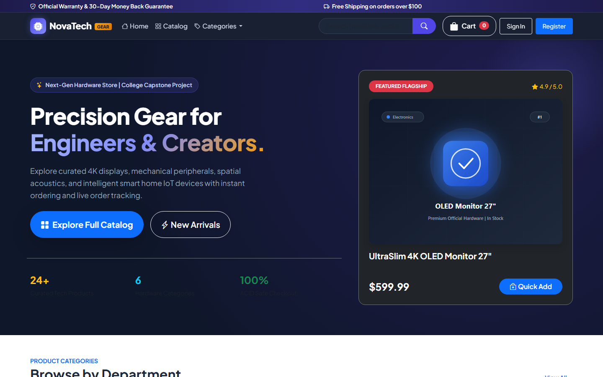
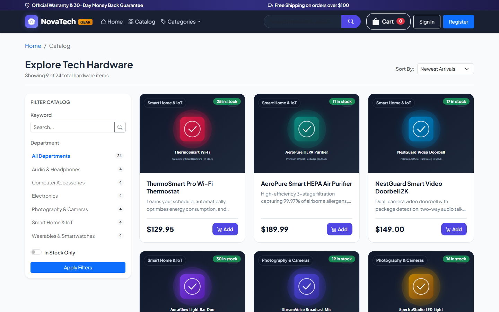
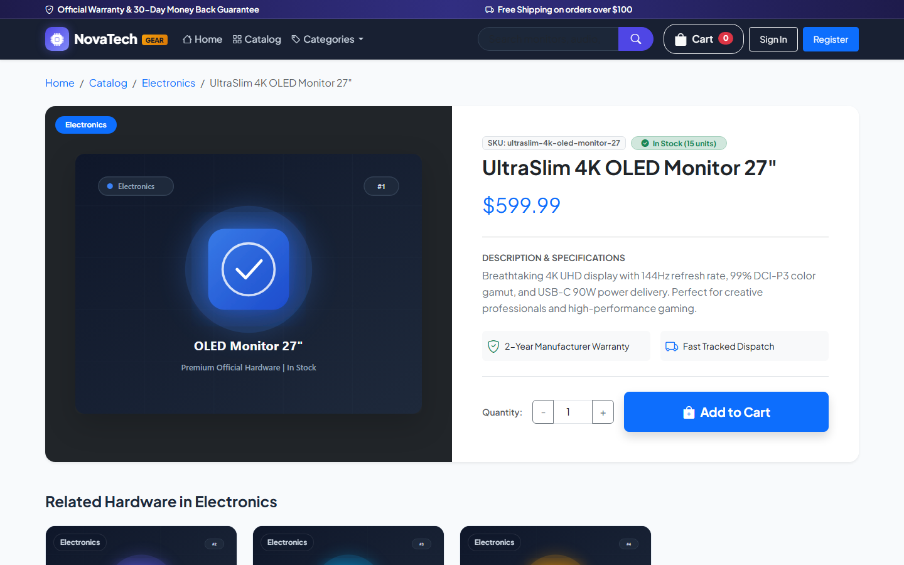
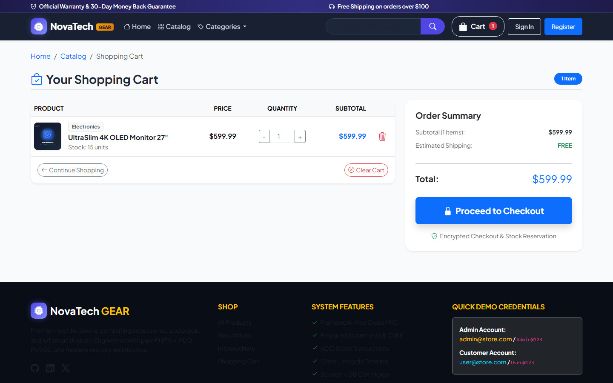
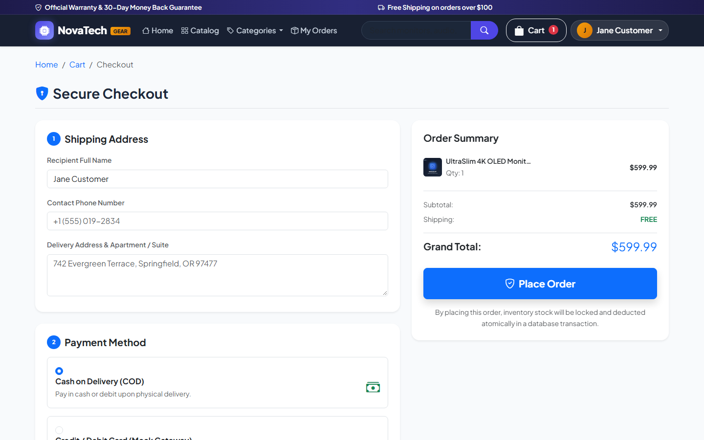
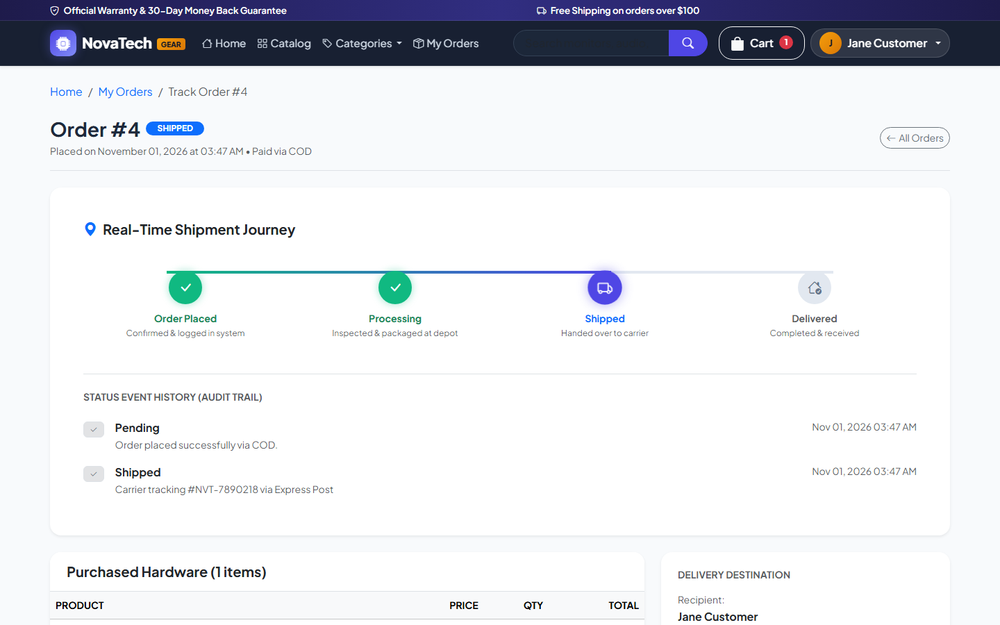
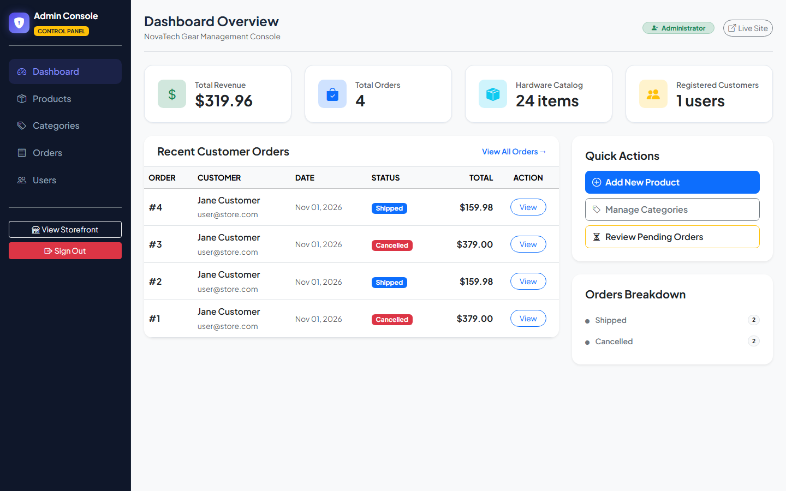
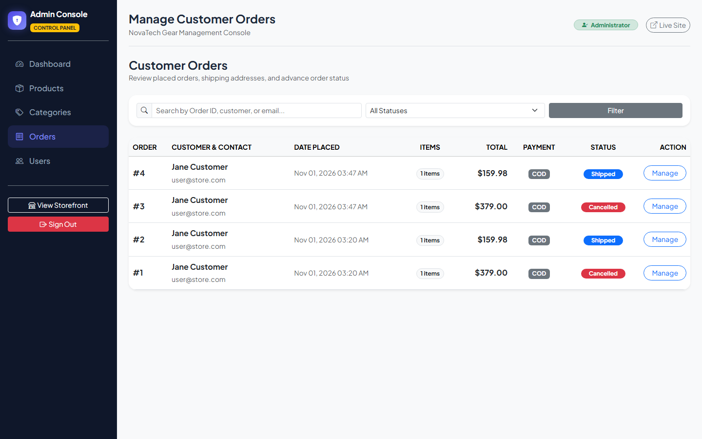
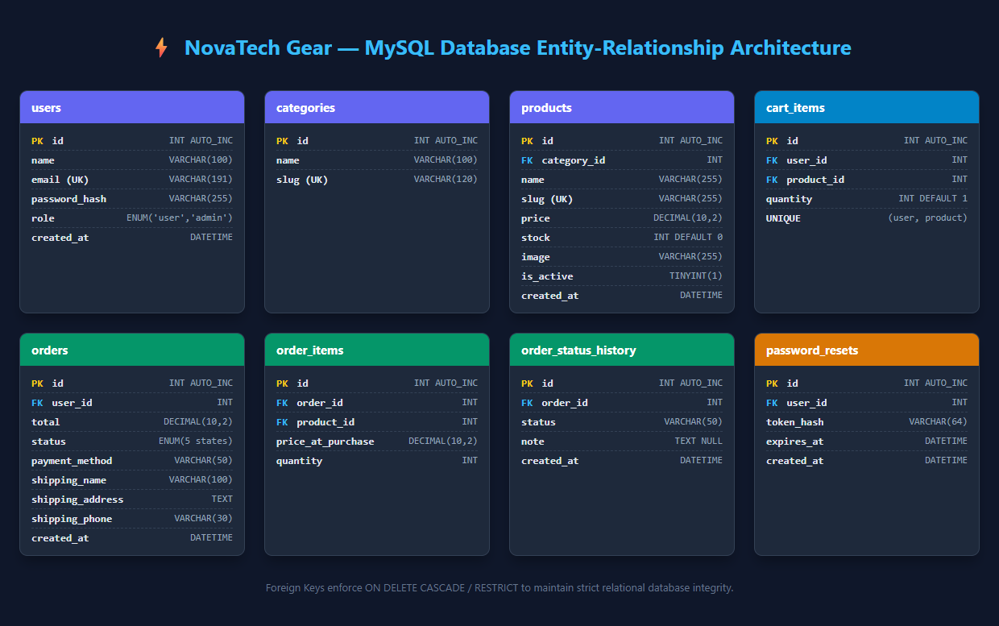
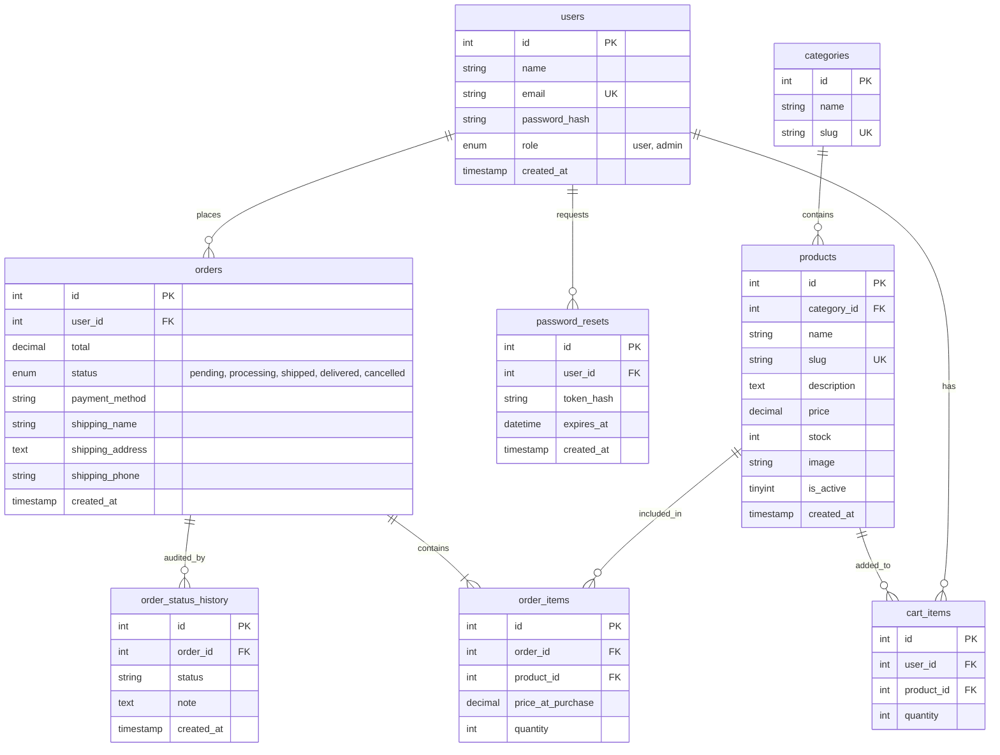

# 🚀 NovaTech Gear — Full-Stack E-Commerce Web Application

> **College Capstone & Final Project** engineered using **pure modern PHP 8.x (no framework, pure PDO)** and **MySQL / MariaDB**.  
> Features clean Model-View-Controller (MVC) architecture, atomic ACID database transactions, role-based authorization (RBAC), CSRF & XSS defenses, rate-limiting, RESTful JSON APIs, and a modern mobile-responsive design system. Runnable locally on XAMPP, WAMP, or `php -S localhost:8000 -t public`.

---

## 📸 Visual Showcase & Application Screenshots

All screenshots are captured live from the running application in `/docs/screenshots`:

### 1. Storefront Home & Featured Hardware

*Hero showcase, department shortcuts, trust badges, featured product cards, and toast notifications.*

---

### 2. Product Catalog with Multi-Facet Filtering & Search

*Instant keyword search, category filter sidebar with dynamic product counts, price/date sorting, in-stock filter, and responsive pagination.*

---

### 3. Product Specifications & Live Stock Detail

*High-resolution hardware showcase, stock inventory badges, quantity selector, specs breakdown, and related category products.*

---

### 4. Dual-Mode Shopping Cart (Guest + Logged-In)

*Line item quantity steppers with real-time stock limits, subtotal calculations, guest session persistence, and auto-merge on login.*

---

### 5. Transactional Checkout & Payment Simulator

*Shipping destination address validation, Cash on Delivery option, and interactive mock card payment gateway (simulates bank approvals and declines).*

---

### 6. Order Tracking & Real-Time Shipment Journey

*4-stage visual journey bar (`Pending` ➔ `Processing` ➔ `Shipped` ➔ `Delivered`), stage timestamps, carrier tracking notes, and purchased item receipts.*

---

### 7. Administrative Analytics Dashboard (`/admin`)

*Executive dashboard: total sales revenue, order counts, product inventory metrics, registered customers, low-stock alerts, and recent order audit.*

---

### 8. Admin Order Oversight & Status Dispatching

*Filter orders by status/keyword, inspect recipient information, advance order lifecycle stages, and record carrier tracking dispatches.*

---

## 📋 Table of Contents
1. [Key Features](#-key-features)
2. [Technology Stack](#-technology-stack)
3. [Database Architecture & ERD](#-database-architecture--erd)
4. [Environment Variables Reference](#-environment-variables-reference)
5. [Local Setup & Running (XAMPP / WAMP & Built-in Server)](#-local-setup--running)
6. [Demo Accounts (Evaluation Only)](#-demo-accounts-evaluation-only)
7. [REST JSON API Documentation](#-rest-json-api-documentation)
8. [Automated Testing & Verification Commands](#-automated-testing--verification-commands)
9. [Security Measures & Hardening](#-security-measures--hardening)
10. [Directory Structure](#-directory-structure)
11. [College Viva & Examination Guide](#-college-viva--examination-guide)

---

## ✨ Key Features

### 1. Product Catalog & Storefront
- **Responsive Product Grid**: Displays product title, category pill, unit price, stock availability badge, and quick "Add to Cart" action.
- **Search & Multi-Facet Filters**: Search products by keyword, filter by department/category, toggle in-stock items, and sort by Newest, Price (Low to High), Price (High to Low), or Name (A-Z).
- **Dynamic Pagination**: Calculates offset, total items, and page counts cleanly.
- **Product Detail View**: High-resolution image showcase, SKU, detailed technical description, real-time inventory counter, quantity stepper, and related recommendations.

### 2. Dual-Mode Shopping Cart (Guest + Logged-in with Auto-Merge)
- **Guest Session Cart**: Anonymous visitors can browse and add items to a PHP session-backed cart (`$_SESSION['_guest_cart']`).
- **Database Persistence**: Authenticated users have their cart stored persistently in the `cart_items` table.
- **Automatic Cart Merge**: Upon login or registration, session cart items are automatically merged into the database cart with inventory availability verification.
- **Live Quantity Controls**: Adjust quantities or remove line items with inventory limits and subtotal re-calculation.

### 3. ACID Transactional Checkout & Order Placement
- **Recipient & Delivery Form**: Validates recipient name, shipping address, and telephone number.
- **Payment Methods**:
  - **Cash on Delivery (COD)**: Order placed immediately; payment collected upon physical delivery.
  - **Mock Card Payment Gateway**: Simulates card processing. A card ending in `0000` simulates bank decline; all other numbers simulate approved payment.
- **Atomic Database Transactions**: Inventory stock is checked and deducted inside a `PDO::beginTransaction()` / `commit()` block. If any item is out of stock, the transaction immediately rolls back to prevent race conditions or negative inventory.

### 4. Real-Time Order Tracking Timeline
- **Order Lifecycle Milestones**: `pending` ➔ `processing` ➔ `shipped` ➔ `delivered` (or `cancelled`).
- **Interactive Visual Timeline**: Graphical step indicator showing completed milestones, active stage with pulsing effect, timestamps, and carrier tracking notes.
- **Cancellation Stock Replenishment**: If an admin cancels an order, line item quantities are automatically restored back to the product's inventory stock.

### 5. Authentication, Roles & Security
- **Secure Password Hashing**: Utilizes `password_hash()` and `password_verify()` with `PASSWORD_BCRYPT` (Cost 10).
- **Session Regeneration**: Session IDs are regenerated upon login (`session_regenerate_id(true)`) to prevent session fixation attacks.
- **Role-Based Access Control (RBAC)**: Reusable middleware enforces `admin` vs `user` permissions with controller-level defense-in-depth constructors.
- **Brute-Force Rate Limiting**: Tracks failed login attempts. Temporarily locks out accounts after 5 failed tries for 15 minutes.
- **Tokenized Password Reset**: Secure cryptographically generated tokens (`bin2hex(random_bytes(32))`) with SHA-256 hash storage and 1-hour expiration.

### 6. Full Administrative Control Panel (`/admin`)
- **Executive Metrics Dashboard**: Real-time sales revenue, order count, total products, customer count, low-stock warnings, and recent order history.
- **Product CRUD**: Add, edit, deactivate, or delete items with secure file upload handling (MIME verification, size caps, randomized filenames).
- **Category CRUD**: Manage product departments and auto-generate clean URL slugs.
- **Order Management**: Filter orders by status or keyword, inspect details, advance order status, and log carrier tracking notes.
- **Customer Oversight**: View all registered users, registration dates, total orders placed, and lifetime spend.

---

## 🛠️ Technology Stack

| Layer | Technologies & Standards | Purpose / Implementation |
| :--- | :--- | :--- |
| **Backend Language** | **PHP 8.x** (Strict Types `declare(strict_types=1)`) | Custom PSR-4 autoloading, pure native PDO, zero external frameworks. |
| **Primary Database** | **MySQL 8.x / MariaDB 10.x+** | Relational schema, foreign key constraints (`CASCADE` / `RESTRICT`), atomic ACID transactions. |
| **Fallback Database** | **SQLite 3** (Explicit opt-in via `DB_DRIVER=sqlite`) | Portable zero-config standalone evaluation mode. |
| **Architecture** | **MVC + Front Controller Pattern** | Clean separation of business models, view templates, and routing controllers. |
| **Frontend Framework** | **HTML5 + CSS3 Custom Properties + Bootstrap 5.3** | Bespoke dark-accented modern design system, mobile-first responsive grid. |
| **Icons & Typography** | **Bootstrap Icons + Plus Jakarta Sans** | Modern developer-focused aesthetic. |
| **Client Scripting** | **Vanilla JavaScript (ES6+ Fetch API)** | AJAX cart addition, live toast alerts, file upload image previews, password visibility toggles. |

---

## 🗄️ Database Architecture & ERD

### Entity-Relationship Diagram (ERD)




---

## ⚙️ Environment Variables Reference

Configuration is managed via `.env` in the project root (outside the public directory). Copy `.env.example` to `.env` to customize settings:

| Variable | Default Value | Description |
| :--- | :--- | :--- |
| `APP_NAME` | `"NovaTech Gear"` | Application display name across title tags and navigation bars. |
| `APP_ENV` | `development` | Environment mode (`development` or `production`). |
| `APP_DEBUG` | `true` | When `true`, displays detailed error traces; when `false`, renders friendly error pages. |
| `APP_DEMO` | `false` (default) / `true` (eval) | Controls the "1-Click Demo Login" helper button on `/login`. Enabled during viva demonstrations. |
| `APP_URL` | `http://localhost:8000` | Application root URL. |
| `APP_SECRET` | `a8b3c4d5e...` | Cryptographic application secret key. |
| `DB_DRIVER` | `mysql` | Primary database driver (`mysql` by default; set `sqlite` for explicit standalone mode). |
| `DB_HOST` | `127.0.0.1` | MySQL server host. |
| `DB_PORT` | `3306` | MySQL server port. |
| `DB_NAME` | `ecommerce_db` | MySQL database name. |
| `DB_USER` | `root` | MySQL user account. |
| `DB_PASS` | `""` | MySQL user password (blank by default on XAMPP). |
| `DB_CHARSET` | `utf8mb4` | MySQL character encoding. |
| `DB_SQLITE_PATH` | `database/store.sqlite` | Filepath for SQLite fallback (only used if `DB_DRIVER=sqlite`). |
| `SESSION_LIFETIME` | `7200` | Session lifetime in seconds (2 hours). |
| `LOGIN_MAX_ATTEMPTS` | `5` | Maximum failed login attempts before temporary lockout. |
| `LOGIN_LOCKOUT_MINUTES` | `15` | Brute-force lockout duration in minutes. |
| `UPLOAD_MAX_BYTES` | `5242880` | Maximum file upload size in bytes (5 MB). |
| `ALLOWED_IMAGE_TYPES` | `image/jpeg,...` | Comma-separated list of permitted upload MIME types. |

---

## 🚀 Local Setup & Running

NovaTech Gear uses **MySQL** as its primary production-grade database. An explicit opt-in SQLite driver is also provided for quick standalone demonstrations (`DB_DRIVER=sqlite`).

### Option A: Using XAMPP / WAMP with phpMyAdmin (Recommended for College Lab)
1. Start **Apache** and **MySQL** in your XAMPP or WAMP Control Panel.
2. Open **phpMyAdmin** in your browser at:
   ```text
   http://localhost/phpmyadmin
   ```
3. Click **New** on the left navigation panel and create a database named:
   ```text
   ecommerce_db
   ```
   *(Collation: `utf8mb4_unicode_ci`)*
4. Select the newly created `ecommerce_db` database, navigate to the **Import** tab at the top:
   - Click **Browse / Choose File** and select `database/schema.sql`, then click **Import** (or **Go**).
   - Once schema import completes, repeat the step and import `database/seed.sql` to populate default admin, user, categories, and products.
5. Place the project folder into your web root (e.g. `C:/xampp/htdocs/ecommerce`).
6. Copy `.env.example` to `.env` and verify database credentials:
   ```ini
   DB_DRIVER=mysql
   DB_HOST=127.0.0.1
   DB_PORT=3306
   DB_NAME=ecommerce_db
   DB_USER=root
   DB_PASS=
   APP_DEMO=true
   ```
7. Open **`http://localhost/ecommerce/public/`** (or run `php -S localhost:8000 -t public` and open `http://localhost:8000`).

---

### Option B: Automated CLI Migration (One-Command Database Setup)
Instead of manual phpMyAdmin imports, you can execute the automated CLI migration tool:
```bash
# 1. Run migrations & seeding on your primary MySQL database:
php database/migrate.php

# 2. Start the local PHP development server:
php -S localhost:8000 -t public
```
> **What `database/migrate.php` does:**
> - Connects to MySQL on the host and port specified in your `.env`.
> - Automatically creates `ecommerce_db` if it doesn't already exist.
> - Applies `database/schema.sql` (creating all 8 relational tables with constraints and foreign keys).
> - Applies `database/seed.sql` (seeding default accounts, categories, and inventory).
> - If MySQL is not running or unreachable, `database/migrate.php` halts with an explicit error and troubleshooting checklist (it does **not** silently switch drivers).

---

### Option C: Explicit SQLite Standalone Mode (Zero-Config Fallback)
If you are evaluating the app on a machine without MySQL/XAMPP installed, you can explicitly opt into standalone SQLite mode:
1. In `.env`, set:
   ```ini
   DB_DRIVER=sqlite
   DB_SQLITE_PATH=database/store.sqlite
   ```
2. Initialize the SQLite schema and seed data via CLI:
   ```bash
   php database/migrate.php --driver=sqlite
   ```
3. Start the server:
   ```bash
   php -S localhost:8000 -t public
   ```

---

## 👥 Demo accounts (evaluation only)

| Role | Email | Password | Access Capabilities |
| :--- | :--- | :--- | :--- |
| **Administrator** | `admin@store.com` | `Admin@123` | Full Admin Console (`/admin`), Sales Metrics, Product & Category CRUD, Order Status Transitions (`Pending` ➔ `Processing` ➔ `Shipped` ➔ `Delivered` / `Cancelled`), User Audit. |
| **Customer** | `user@store.com` | `User@123` | Storefront catalog browsing, cart operations, checkout, and personal order tracking ("My Orders"). |

> **Note on Demo Mode**: The login page's convenient "1-Click Quick Fill" buttons render **only** when `APP_DEMO=true` is set in `.env`. In `.env.example`, `APP_DEMO=false` is the default to ensure production environments do not expose helper buttons. Set `APP_DEMO=true` during college evaluation and viva demonstrations.

---

## 📡 REST JSON API Documentation

All API endpoints reside under `/api` and return standardized JSON payloads with strict HTTP status codes:

| Method | Endpoint | Auth Required | CSRF Required | Description / Request Payload | Status Codes |
| :--- | :--- | :--- | :--- | :--- | :--- |
| `GET` | `/api/csrf-token` | No | No | Returns active CSRF token for Single Page Applications or API consumers. | `200 OK` |
| `GET` | `/api/products` | No | No | Paginated product catalog. Query params: `q`, `category`, `sort`, `in_stock`, `page`, `per_page`. | `200 OK` |
| `GET` | `/api/products/{id}` | No | No | Detailed specifications for a product by ID or slug. | `200 OK`, `404 Not Found` |
| `GET` | `/api/cart` | No | No | Retrieve line items, quantities, and totals for current visitor/user. | `200 OK` |
| `POST` | `/api/cart/add` | No | **Yes** | Add item to cart. Body: `{"product_id": 1, "quantity": 2}`. | `200 OK`, `400 Bad Request`, `403 Forbidden`, `422 Unprocessable` |
| `POST` | `/api/cart/update` | No | **Yes** | Update quantity. Body: `{"product_id": 1, "quantity": 3}`. | `200 OK`, `400 Bad Request`, `403 Forbidden`, `422 Unprocessable` |
| `POST` | `/api/cart/remove` | No | **Yes** | Remove item from cart. Body: `{"product_id": 1}`. | `200 OK`, `403 Forbidden`, `422 Unprocessable` |
| `GET` | `/api/orders` | **Yes (User)** | No | List order history for the authenticated user. | `200 OK`, `401 Unauthorized` |
| `GET` | `/api/orders/{id}` | **Yes (User)** | No | Get single order details, purchased items, and tracking timeline (scoped to user to prevent IDOR). | `200 OK`, `401 Unauthorized`, `404 Not Found` |
| `POST` | `/api/auth/login` | No | **Yes** | Authenticate credentials. Body: `{"email": "...", "password": "..."}`. | `200 OK`, `401 Unauthorized`, `403 Forbidden`, `429 Rate Limited` |
| `POST` | `/api/auth/register` | No | **Yes** | Create customer account. Body: `{"name": "...", "email": "...", "password": "..."}`. | `201 Created`, `403 Forbidden`, `422 Unprocessable` |

---

## 🧪 Automated Testing & Verification Commands

The project includes 9 automated verification test suites covering every layer of the architecture:

```bash
# 1. Test Authentication, Hashing, RBAC, and Token-based Password Resets
php tests/test_auth.php

# 2. Test Product Catalog, Search, Filtering, and Pagination
php tests/test_catalog.php

# 3. Test Shopping Cart (Guest session, User DB, and auto-merge on login)
php tests/test_cart.php

# 4. Test Orders, Transactional Stock Deduction, and Tracking Timeline
php tests/test_orders.php

# 5. Test Admin Metrics, Product/Category CRUD, and User Oversight
php tests/test_admin.php

# 6. Test REST JSON APIs under /api
php tests/test_api.php

# 7. Test Demo Mode quick-fill conditional rendering
php tests/test_demo_mode.php

# 8. Test Comprehensive Security Audit (SQLi, CSRF, IDOR, RBAC, XSS)
php tests/test_security_audit.php

# 9. Test End-to-End Browser HTTP Flow (Customer buy -> Admin ship -> Customer track)
php tests/test_e2e_flow.php
```

To run all automated test suites sequentially in PowerShell / Terminal:
```bash
php tests/test_auth.php; php tests/test_catalog.php; php tests/test_cart.php; php tests/test_orders.php; php tests/test_admin.php; php tests/test_api.php; php tests/test_demo_mode.php; php tests/test_security_audit.php; php tests/test_e2e_flow.php
```

---

## 🔒 Security Measures & Hardening

| Threat / Vulnerability | Countermeasure Implemented | Code Location & Mechanism |
| :--- | :--- | :--- |
| **SQL Injection (SQLi)** | 100% Prepared Statements via PDO with parameterized bindings (`:param`). Database table and column names validated against strict identifier regex `^[a-zA-Z0-9_]+$`. | `app/core/Database.php`<br>`app/models/Model.php` |
| **Cross-Site Request Forgery (CSRF)** | 32-byte cryptographically secure tokens (`random_bytes(32)`) validated using timing-attack safe `hash_equals()`. Enforced on **all** POST/PUT/DELETE web forms and `/api` state-changing endpoints. Accepts form inputs and `X-CSRF-TOKEN` headers. | `app/core/Csrf.php`<br>`app/controllers/Controller.php`<br>`app/controllers/ApiController.php` |
| **Cross-Site Scripting (XSS)** | Global `e()` escaping wrapper calling `htmlspecialchars($val, ENT_QUOTES, 'UTF-8')` across all view templates. Flash alerts sanitized against malicious script tags and `javascript:` URLs. | `app/core/helpers.php`<br>`app/views/layouts/alerts.php` |
| **Insecure Direct Object References (IDOR)** | Customer order views strictly scope queries by user ID (`Order::findWithDetails($orderId, $userId)`). Users cannot view or track orders belonging to other customers by tampering with the URL. | `app/controllers/OrderController.php`<br>`app/controllers/ApiController.php`<br>`app/models/Order.php` |
| **Privilege Escalation** | Admin routes protected by `admin` route middleware. `AdminController` also enforces `Auth::requireAdmin()` directly in its `__construct()` method for defense-in-depth. | `app/core/Auth.php`<br>`app/controllers/AdminController.php` |
| **Credential Brute-Forcing** | Login attempts rate-limited per email and IP address. Accounts temporarily locked for 15 minutes after 5 consecutive failed attempts. | `app/core/Auth.php` (`isRateLimited`, `incrementLoginAttempts`) |
| **Session Fixation** | Session IDs regenerated (`session_regenerate_id(true)`) upon every login and logout. | `app/core/Session.php`<br>`app/core/Auth.php` |
| **Unsafe File Uploads** | Uploaded product images verified via PHP `finfo_file` (real MIME type check, not just file extension), restricted to JPG/PNG/WEBP/SVG, capped at 5MB, and stored with randomized filenames (`product_<uniqid>.<ext>`). | `app/controllers/AdminController.php` (`handleImageUpload`) |
| **Secrets Exposure & Git Safety** | Credentials stored in `.env` outside the public web root. `.gitignore` strictly excludes `.env`, `*.sqlite`, and user uploads. | `.gitignore`<br>`app/config/config.php` |

---

## 📁 Directory Structure

```text
E-Commerce Web Application/
├── app/
│   ├── config/
│   │   ├── config.php            # Environment configuration parser & security constants
│   │   └── database.php          # Database PDO connection credentials
│   ├── controllers/
│   │   ├── Controller.php        # Abstract base controller (CSRF validation, view renderer)
│   │   ├── HomeController.php    # Storefront landing page & showcase
│   │   ├── ProductController.php # Catalog grid, multi-facet filtering, product details
│   │   ├── CartController.php    # Guest session cart & database cart operations
│   │   ├── CheckoutController.php# Address form, mock payments, ACID checkout
│   │   ├── OrderController.php   # Customer "My Orders" & visual tracking timeline
│   │   ├── AuthController.php    # Register, login, logout, password resets
│   │   ├── AdminController.php   # Admin dashboard, product/category/order/user CRUD
│   │   └── ApiController.php     # RESTful JSON APIs (/api) with CSRF protection
│   ├── core/
│   │   ├── Autoloader.php        # PSR-4 Autoloader
│   │   ├── Database.php          # Thread-safe PDO Singleton & query engine
│   │   ├── Router.php            # REST routing with regex parameters & middleware
│   │   ├── Request.php           # HTTP request parser (GET, POST, JSON, headers, IP)
│   │   ├── Response.php          # HTTP response dispatcher & JSON output
│   │   ├── View.php              # Safe template renderer
│   │   ├── Session.php           # Secure cookie session & flash messaging
│   │   ├── Auth.php              # RBAC middleware & login rate-limiter
│   │   ├── Csrf.php              # Cryptographic CSRF token generator & validator
│   │   ├── Validator.php         # Input validation engine
│   │   └── helpers.php           # Global helper functions (e, csrf_field, format_price)
│   ├── models/
│   │   ├── Model.php             # Abstract Active Record base model
│   │   ├── User.php              # User accounts & auth queries
│   │   ├── Category.php          # Product taxonomy & slug generator
│   │   ├── Product.php           # Inventory & catalog queries
│   │   ├── Cart.php              # Cart calculations & guest-to-user merger
│   │   ├── Order.php             # Orders & transactional checkout logic
│   │   ├── OrderStatusHistory.php# Order status timeline audits
│   │   └── PasswordReset.php     # Token-based password recovery
│   └── views/
│       ├── layouts/              # Header, footer, admin sidebar, alert partials
│       ├── home/                 # Homepage template
│       ├── products/             # Catalog & detail templates
│       ├── cart/                 # Shopping cart template
│       ├── checkout/             # Checkout & order confirmation templates
│       ├── orders/               # "My Orders" & live tracking timeline templates
│       ├── auth/                 # Sign in, register, forgot/reset password templates
│       ├── admin/                # Dashboard, product/category/order/user management
│       └── errors/               # 403, 404, 500, and database error templates
├── database/
│   ├── schema.sql                # MySQL schema with FK constraints and indexes
│   ├── seed.sql                  # Seed data (Admin, customer, 6 categories, 24 products)
│   ├── migrate.php               # CLI migration & seeder tool
│   └── generate_images.php       # Product vector illustration generator
├── docs/
│   ├── screenshots/              # 8 application screenshots
│   ├── erd.png                   # Database ERD graphic
│   └── TESTING.md                # Comprehensive manual test checklist
├── public/
│   ├── assets/
│   │   ├── css/style.css         # Modern bespoke design system
│   │   └── js/app.js             # AJAX cart, toast alerts, image preview, password toggle
│   ├── uploads/products/         # 24 seed SVG hardware illustrations & uploaded photos
│   └── index.php                 # Front controller entrypoint
├── scripts/
│   └── capture_screenshots.js    # Automated headless browser screenshot generator
├── tests/                        # 9 automated test suites
├── .env.example                  # Environment configuration template
├── .gitignore                    # Git exclusion rules
└── README.md                     # Project documentation
```

---

## 🎓 College Viva & Examination Guide

### Q1: Why use pure PHP 8.x and PDO instead of a framework like Laravel?
> **Answer**: Developing without a heavy framework demonstrates fundamental full-stack software engineering competence. It proves understanding of core architectural concepts from first principles: writing a custom PSR-4 autoloader, building a dynamic regex-based router with middleware pipelines, managing stateful sessions, designing PDO prepared statements with transactions, and enforcing security controls (CSRF, XSS, rate-limiting, and IDOR prevention) without framework magic.

### Q2: How does the shopping cart handle both guests and registered users?
> **Answer**: For guests, items are stored in `$_SESSION['_guest_cart']`. When the customer logs in or registers, `Auth::login()` automatically executes `Cart::mergeGuestCart($userId)`. Any existing items in the session are transferred to the `cart_items` table in MySQL (updating quantities up to available inventory) and the guest session is cleanly purged.

### Q3: How are race conditions prevented during checkout when inventory is low?
> **Answer**: `Order::createOrder()` wraps the entire checkout inside an atomic database transaction (`$pdo->beginTransaction()`). For every cart item, it checks current inventory and runs:
> ```sql
> UPDATE products SET stock = stock - :qty WHERE id = :id AND stock >= :min_stock
> ```
> If `rowCount()` is 0 (meaning another customer bought the last unit concurrently), an exception is thrown and `$pdo->rollBack()` restores the state, guaranteeing zero overselling and data consistency.

### Q4: How is the order tracking timeline implemented?
> **Answer**: Every status change (initial placement, admin processing, dispatch, delivery, or cancellation) creates an immutable record in `order_status_history` with the foreign key `order_id`, new status, administrator note, and timestamp. The customer tracking view queries these records to render a dynamic multi-stage visual journey bar.

### Q5: What is IDOR and how is it prevented in this application?
> **Answer**: Insecure Direct Object Reference (IDOR) occurs when an application exposes a direct database key (like `/orders/5`) without verifying that the requesting user owns that record. In NovaTech Gear, `OrderController::show` and `ApiController::orderDetail` strictly pass the authenticated user ID (`$userId = Auth::isAdmin() ? null : (int) Auth::id()`) to `Order::findWithDetails($orderId, $userId)`. A customer attempting to view another customer's order by changing the ID in the URL receives a 404 / Access Denied error.
