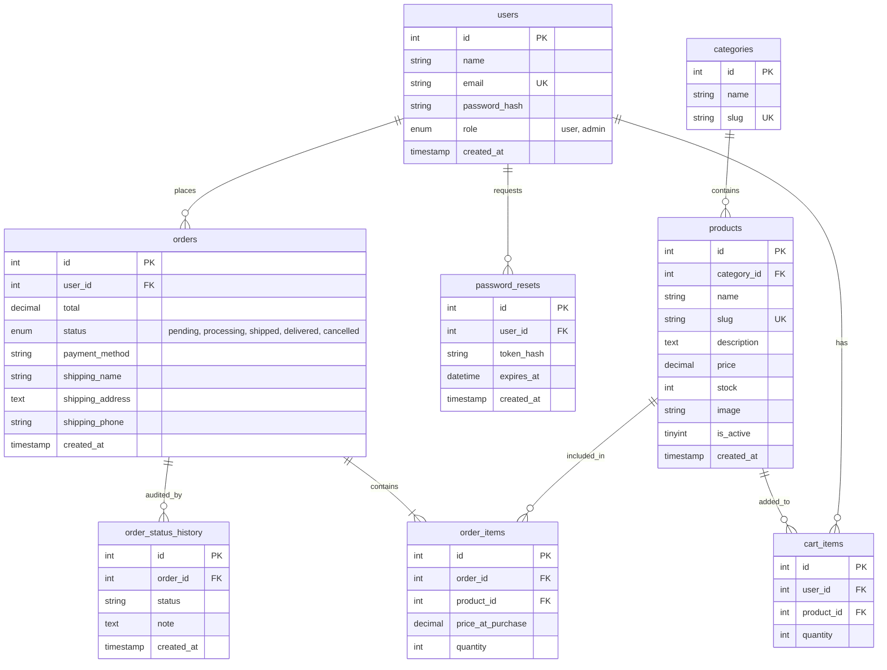

# 🚀 NovaTech Gear — Full-Stack E-Commerce Web Application

> **College Capstone Project** built using **modern PHP 8.x (no framework, pure PDO)** and **MySQL / MariaDB**.  
> Engineered with clean MVC separation, atomic ACID transactions, role-based authorization, rate-limiting, and RESTful JSON APIs. Runnable locally with XAMPP, WAMP, or `php -S localhost:8000 -t public`.

---

## 📋 Table of Contents
1. [Key Features](#key-features)
2. [Database Architecture & ERD](#database-architecture--erd)
3. [Technology Stack](#technology-stack)
4. [Project Directory Structure](#project-directory-structure)
5. [Local Setup & Running](#local-setup--running)
6. [Demo Accounts](#demo-accounts)
7. [REST JSON API Documentation](#rest-json-api-documentation)
8. [Security Implementation](#security-implementation)
9. [College Viva & Examination Guide](#college-viva--examination-guide)

---

## ✨ Key Features

### 1. Product Catalog & Storefront
- **Responsive Product Grid**: Displays product image, title, unit price, category, and live stock badge.
- **Search & Multi-Facet Filters**: Instant search by keyword, filter by department/category, toggle in-stock items.
- **Sorting Options**: Sort by Newest, Price (Low to High), Price (High to Low), or Name (A-Z).
- **Pagination**: Paginated navigation calculating total pages and offset.
- **Product Detail Page**: High-resolution image view, SKU, detailed technical specs, real-time stock availability, quantity selector, and related products in the same category.

### 2. Dual-Mode Shopping Cart (Guest + Logged-in with Auto-Merge)
- **Guest Session Cart**: Anonymous visitors can browse and add items to a secure PHP session-backed cart.
- **Database Persistence**: Registered customers have their cart stored in the `cart_items` table.
- **Automatic Cart Merge**: When a guest signs in or creates an account, items stored in their session cart are automatically merged into their database cart.
- **Live Quantity Controls**: Update quantities or remove line items with automatic inventory limit checks and instant subtotal re-calculation.

### 3. ACID Transactional Checkout & Order Placement
- **Recipient & Shipping Form**: Validates recipient name, delivery address, and telephone number.
- **Payment Methods**:
  - **Cash on Delivery (COD)**: Order placed immediately; pay upon physical delivery.
  - **Mock Card Payment Gateway**: Simulates card processing. A test card ending in `0000` simulates bank decline; all other numbers simulate approved payment.
- **Atomic Database Transactions**: Inventory stock is checked and deducted inside a `PDO::beginTransaction()` / `commit()` block. If any product is out of stock, the transaction immediately rolls back to prevent race conditions or negative inventory.

### 4. Real-Time Order Tracking Timeline
- **Order Lifecycle Milestones**: `pending` ➔ `processing` ➔ `shipped` ➔ `delivered` (or `cancelled`).
- **Interactive Visual Timeline**: Graphical step indicator showing completed milestones, active stage with pulsing effect, timestamps, and carrier tracking notes.
- **Cancellation Stock Replenishment**: If an admin cancels an order, line item quantities are automatically restored back to the product's inventory stock.

### 5. Authentication, Roles & Security
- **Secure Password Hashing**: Utilizes `password_hash()` and `password_verify()` with `PASSWORD_BCRYPT` (Cost 10).
- **Session Regeneration**: Session IDs are regenerated upon login (`session_regenerate_id(true)`) to prevent session fixation attacks.
- **Role-Based Access Control (RBAC)**: Reusable middleware enforces `admin` vs `user` permissions.
- **Brute-Force Rate Limiting**: Tracks failed login attempts. Temporarily locks out accounts after 5 failed tries for 15 minutes.
- **Tokenized Password Reset**: Secure cryptographically generated tokens (`bin2hex(random_bytes(32))`) with SHA-256 hash storage and 1-hour expiration.

### 6. Full Administrative Control Panel (`/admin`)
- **Executive Metrics Dashboard**: Real-time sales revenue, order count, total products, customer count, low-stock warnings, and recent order history.
- **Product CRUD**: Add, edit, deactivate, or delete items with secure file upload handling (MIME verification, size caps, randomized filenames).
- **Category CRUD**: Manage product departments and auto-generate clean URL slugs.
- **Order Management**: Filter orders by status or keyword, inspect details, advance order status, and log carrier tracking notes.
- **Customer Oversight**: View all registered users, registration dates, total orders placed, and lifetime spend.

---

## 🗄️ Database Architecture & ERD



---

## 🛠️ Technology Stack
- **Backend**: PHP 8.x (strict types, PSR-4 autoloading, pure PDO)
- **Database**: MySQL 8.x / MariaDB (with seamless SQLite fallback for instant demo portability)
- **Frontend**: HTML5, CSS3 Custom Properties (Design System), Bootstrap 5.3 utilities, Bootstrap Icons, Vanilla JavaScript (ES6+ fetch API)
- **Architecture**: Model-View-Controller (MVC) with Front Controller pattern

---

## 📁 Project Directory Structure

```text
E-Commerce Web Application/
├── app/
│   ├── config/
│   │   ├── config.php            # Application & security settings (.env parser)
│   │   └── database.php          # Database credentials & PDO connection configs
│   ├── controllers/
│   │   ├── Controller.php        # Base controller (view, json, redirect, csrf validation)
│   │   ├── HomeController.php    # Storefront landing page & showcase
│   │   ├── ProductController.php # Catalog, filtering, search, pagination, detail
│   │   ├── CartController.php    # Guest + user cart operations
│   │   ├── CheckoutController.php# Address form, mock payments, transaction execution
│   │   ├── OrderController.php   # Customer "My Orders" & live timeline tracking
│   │   ├── AuthController.php    # Register, login, logout, password resets
│   │   ├── AdminController.php   # Admin dashboard, product/category/order/user CRUD
│   │   └── ApiController.php     # RESTful JSON APIs (/api)
│   ├── core/
│   │   ├── Autoloader.php        # PSR-4 Autoloader
│   │   ├── Database.php          # Thread-safe PDO Singleton & query helper
│   │   ├── Router.php            # Dynamic routing with parameterized regex & middleware
│   │   ├── Request.php           # HTTP request parser (GET, POST, JSON, headers, IP)
│   │   ├── Response.php          # HTTP response dispatcher & JSON output
│   │   ├── View.php              # Safe template renderer with e() htmlspecialchars
│   │   ├── Session.php           # Secure cookie session & flash messaging
│   │   ├── Auth.php              # RBAC middleware & login rate-limiter
│   │   ├── Csrf.php              # Cryptographic CSRF token generation & validation
│   │   └── Validator.php         # Input validation engine
│   ├── models/
│   │   ├── Model.php             # Active Record base model
│   │   ├── User.php              # User accounts & auth queries
│   │   ├── Category.php          # Product taxonomy & slug generator
│   │   ├── Product.php           # Inventory & catalog queries
│   │   ├── Cart.php              # Cart calculations & guest-to-user merger
│   │   ├── Order.php             # Orders & transactional checkout logic
│   │   ├── OrderStatusHistory.php# Order status timeline audits
│   │   └── PasswordReset.php     # Token-based password recovery
│   └── views/
│       ├── layouts/              # Header, footer, admin sidebar, alert partials
│       ├── home/                 # Homepage template
│       ├── products/             # Catalog & detail templates
│       ├── cart/                 # Shopping cart template
│       ├── checkout/             # Checkout & order confirmation templates
│       ├── orders/               # "My Orders" & live tracking timeline templates
│       ├── auth/                 # Sign in, register, forgot/reset password templates
│       ├── admin/                # Dashboard, product/category/order/user management
│       └── errors/               # 404, 403, and 500 error templates
├── database/
│   ├── schema.sql                # MySQL schema with FKs and constraints
│   ├── seed.sql                  # Seed data (Admin, customer, 6 categories, 24 products)
│   ├── migrate.php               # CLI migration & seeder tool
│   └── generate_images.php       # Product vector illustration generator
├── docs/
│   └── TESTING.md                # Comprehensive manual test checklist
├── public/
│   ├── assets/
│   │   ├── css/style.css         # Modern bespoke design system
│   │   └── js/app.js             # AJAX cart, toast alerts, image preview, password toggle
│   ├── uploads/products/         # 24 seed SVG hardware illustrations & uploaded photos
│   └── index.php                 # Front controller entrypoint
├── tests/                        # Automated unit & integration verification scripts
├── .env.example                  # Environment template
├── .env                          # Local environment variables
└── README.md                     # Project documentation
```

---

## 🚀 Local Setup & Running

### Option A: Using Built-in PHP Server (Fastest — 1 Step)
```bash
# 1. Start built-in web server from the project root:
php -S localhost:8000 -t public
```
Open **[http://localhost:8000](http://localhost:8000)** in any web browser.  
*(Database auto-connects to MySQL if running on port 3306, or seamlessly uses the included SQLite database zero-configuration).*

---

### Option B: Using XAMPP / WAMP
1. Start **Apache** and **MySQL** in the XAMPP / WAMP Control Panel.
2. Open **phpMyAdmin** (`http://localhost/phpmyadmin`).
3. Create a database named `ecommerce_db`.
4. Import `database/schema.sql` and then `database/seed.sql`.
5. Move the project folder to `C:/xampp/htdocs/ecommerce` (or configure a VirtualHost pointing to `/public`).
6. Update `.env` if your MySQL password is not blank:
   ```ini
   DB_DRIVER=mysql
   DB_HOST=127.0.0.1
   DB_PORT=3306
   DB_NAME=ecommerce_db
   DB_USER=root
   DB_PASS=
   ```
7. Open **`http://localhost/ecommerce/public/`** (or `http://localhost:8000`).

---

### Option C: Database Migration via CLI
You can migrate and seed the database anytime via terminal:
```bash
# Migrate and seed default database:
php database/migrate.php

# Force SQLite standalone driver:
php database/migrate.php --driver=sqlite
```

---

## 👥 Demo Accounts

| Role | Email | Password | Access Capabilities |
| :--- | :--- | :--- | :--- |
| **Administrator** | `admin@store.com` | `Admin@123` | Full Admin Console (`/admin`), Sales Metrics, Product & Category CRUD, Advance Order Statuses (`Pending` ➔ `Processing` ➔ `Shipped` ➔ `Delivered` / `Cancelled`), User Audit. |
| **Customer** | `user@store.com` | `User@123` | Storefront catalog browsing, cart operations, checkout, and personal order tracking ("My Orders"). |

*(Note: The login page includes a convenient **1-Click Quick Fill** button for instant demo evaluation).*

---

## 📡 REST JSON API Documentation

All endpoints return standardized JSON payloads with appropriate HTTP status codes.

### 1. Products API
- **`GET /api/products`**  
  Retrieve paginated product catalog with optional query filters:
  - Query parameters: `?q=`, `?category=`, `?sort=`, `?in_stock=`, `?page=`, `?per_page=`
  - **Status Code**: `200 OK`
  - **Sample Response**:
    ```json
    {
      "success": true,
      "data": [
        {
          "id": 1,
          "name": "UltraSlim 4K OLED Monitor 27\"",
          "slug": "ultraslim-4k-oled-monitor-27",
          "price": 599.99,
          "stock": 15,
          "category_name": "Electronics",
          "image": "product-1.svg"
        }
      ],
      "pagination": {
        "current_page": 1,
        "total_pages": 3,
        "total_items": 24,
        "per_page": 12
      }
    }
    ```

- **`GET /api/products/{id}`**  
  Retrieve detailed specifications for a single product by ID or slug.  
  - **Status Codes**: `200 OK`, `404 Not Found`

---

### 2. Shopping Cart API
- **`GET /api/cart`**  
  Retrieve items and calculated totals for current visitor session or user account.  
  - **Status Code**: `200 OK`

- **`POST /api/cart/add`**  
  Add an item to the shopping cart.  
  - **Body** (JSON or Form-Data): `{"product_id": 1, "quantity": 2}`  
  - **Status Codes**: `200 OK`, `400 Bad Request` (exceeds inventory), `422 Unprocessable Content`

- **`POST /api/cart/update`**  
  Adjust the quantity of an item in the cart.  
  - **Body**: `{"product_id": 1, "quantity": 3}`  
  - **Status Codes**: `200 OK`, `400 Bad Request`

- **`POST /api/cart/remove`**  
  Remove an item from the cart.  
  - **Body**: `{"product_id": 1}`  
  - **Status Code**: `200 OK`

---

### 3. Orders API
- **`GET /api/orders`**  
  List orders belonging to the authenticated customer.  
  - **Status Codes**: `200 OK`, `401 Unauthorized`

- **`GET /api/orders/{id}`**  
  Retrieve single order details, purchased items, and chronological status tracking timeline.  
  - **Status Codes**: `200 OK`, `401 Unauthorized`, `404 Not Found`

---

### 4. Authentication API
- **`POST /api/auth/login`**  
  Authenticate credentials and start session.  
  - **Body**: `{"email": "user@store.com", "password": "User@123"}`  
  - **Status Codes**: `200 OK`, `401 Unauthorized`, `422 Unprocessable Content`, `429 Too Many Requests` (Rate Limited)

- **`POST /api/auth/register`**  
  Create a new customer account.  
  - **Body**: `{"name": "Jane", "email": "jane@store.com", "password": "SecretPassword"}`  
  - **Status Codes**: `201 Created`, `422 Unprocessable Content`

---

## 🔒 Security Implementation

| Security Control | Implementation Method | Purpose / Defense |
| :--- | :--- | :--- |
| **SQL Injection Defense** | PDO Prepared Statements with parameterized binds (`:param`) across 100% of queries. | Prevents attacker SQL injection. |
| **Cross-Site Request Forgery (CSRF)** | 32-byte cryptographic tokens (`Csrf.php`) validated on all POST/PUT/DELETE forms using timing-safe `hash_equals()`. | Prevents unauthorized cross-origin state changes. |
| **Cross-Site Scripting (XSS)** | Global `e()` escaping wrapper calling `htmlspecialchars($val, ENT_QUOTES, 'UTF-8')`. | Neutralizes malicious script injection in templates. |
| **Session Fixation Defense** | `Session::regenerate(true)` called upon login and logout. | Prevents attackers from hijacking authenticated sessions. |
| **File Upload Hardening** | Validates MIME type via `finfo_file()`, checks file size (≤ 5MB), and assigns randomized names (`product_xxx.ext`). | Blocks malicious executable scripts (e.g. `.php` uploads). |
| **Brute-Force Rate Limiting** | Tracks failed attempts per account/IP. Locks login after 5 failures for 15 minutes. | Neutralizes automated dictionary and credential stuffing attacks. |
| **Environment Separation** | Database credentials and secrets stored in `.env` / `config.php` outside the public web root. | Prevents exposure of sensitive credentials. |

---

## 🎓 College Viva & Examination Guide

### Q1: Why use pure PHP and PDO instead of a framework like Laravel?
> **Answer**: Developing without a heavy framework demonstrates fundamental full-stack engineering skills: implementing custom PSR-4 autoloading, Front Controller architecture, REST routing with regular expressions, SQL database transaction handling, and security mechanisms (CSRF, XSS, rate-limiting) from first principles.

### Q2: How does the shopping cart handle both guests and registered users?
> **Answer**: Guests store cart items in `$_SESSION['_guest_cart']`. When a user authenticates, `Auth::login()` automatically invokes `Cart::mergeGuestCart($userId)`. Any existing items in the session are transferred to the `cart_items` table (updating quantities up to available stock) and the guest session is cleared.

### Q3: How are race conditions prevented during checkout when stock is low?
> **Answer**: `Order::createOrder()` wraps the entire checkout inside a database transaction (`$pdo->beginTransaction()`). For every cart item, it checks current inventory and runs `UPDATE products SET stock = stock - :qty WHERE id = :id AND stock >= :qty`. If row count is 0 (stock insufficient), an exception is thrown and `$pdo->rollBack()` restores the state, guaranteeing zero overselling.

### Q4: How is the order tracking timeline implemented?
> **Answer**: Every status change (initial placement, admin processing, dispatch, delivery, or cancellation) creates an immutable record in `order_status_history` with the foreign key `order_id`, new status, administrator note, and timestamp. The customer tracking view queries these records to render a dynamic multi-stage visual journey bar.
